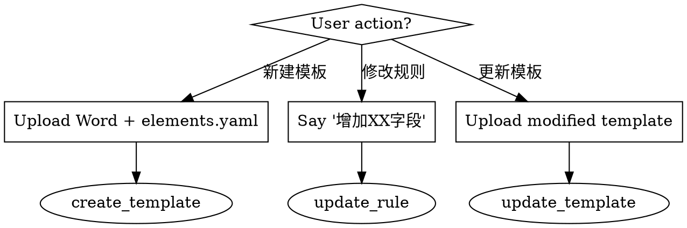
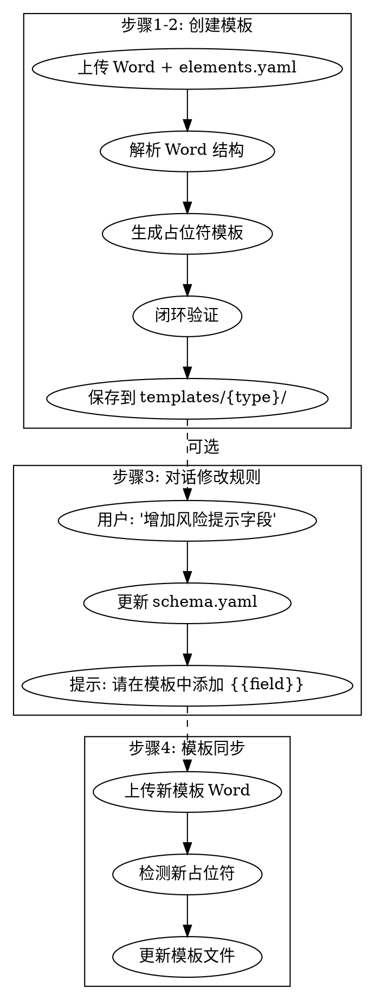

# 模板制作与维护工作流

## Overview

业务人员通过对话方式管理报告模板和提取规则，无需研发介入。核心原则：**上传样本 → 自动构建验证 → 对话修改规则 → 模板同步**。

## When to Use



**Use when:**
- 用户上传 Word 样本说"将其设为XX报告模板"
- 用户说"增加/修改/删除'XX'字段"
- 用户上传带新占位符的模板文件

**Do NOT use for:**
- 分析师日常报告生成（场景二）
- 报告审核流程

## Core Workflow



## Quick Reference

| 用户指令 | 触发动作 | 输出 |
|---------|----------|------|
| "将其设为宏观报告模板" | create_template | 模板创建成功，列出占位符 |
| "增加'风险提示'字段" | update_rule (add) | 已增加字段，提示更新模板 |
| "修改'评级'字段" | update_rule (modify) | 已修改字段 |
| "删除'XX'字段" | update_rule (delete) | 已删除字段 |
| "更新模板" + 上传文件 | update_template | 模板更新成功，列出新占位符 |
| "验证模板" | validate_template | 验证结果（通过/差异） |

## Implementation

### 1. 创建模板 (create_template)

**触发条件:** 用户上传 Word + elements.yaml，说"设为{type}报告模板"

**执行步骤:**
```python
# 1. 解析 Word
from template_admin.parser import WordParser
parser = WordParser(word_file)
structure = parser.parse_structure()

# 2. 加载要素
import yaml
with open(elements_file) as f:
    elements = yaml.safe_load(f)

# 3. 检测占位符
from template_admin.placeholder_detector import PlaceholderDetector
detector = PlaceholderDetector()
placeholders = []
for para in structure['paragraphs']:
    placeholders.extend(detector.detect_from_content(para['text']))

# 4. 保存模板
import shutil
template_dir = f".opencode/templates/{report_type}"
os.makedirs(template_dir, exist_ok=True)
shutil.copy2(word_file, f"{template_dir}/template.docx")

# 5. 闭环验证
from template_admin.validator import TemplateValidator
validator = TemplateValidator()
result = validator.validate(word_file, template_path, elements)
```

**响应模板:**
```
模板创建成功！🎉

检测到的占位符: {{ticker}}, {{company_name}}, {{rating}}...

下一步: 您可以通过对话方式修改提取规则，例如:
"以后提取宏观报告时，增加一个'风险提示'字段"
```

### 2. 更新规则 (update_rule)

**触发条件:** 用户说"增加/修改/删除'XX'字段"

**执行步骤:**
```python
from rule_manager.feedback_handler import FeedbackHandler

handler = FeedbackHandler()
result = handler.process(feedback, report_type)

# result 包含:
# - success: bool
# - action: 'add' | 'modify' | 'delete'
# - field_name: str
# - template_prompt: str (如果是 add)
```

**响应模板 (add):**
```
已增加'风险提示'字段。

请下载当前的排版模板，在您希望显示该字段的段落输入占位符 
{{风险提示}}，然后上传修改后的 Word 文件。
```

### 3. 更新模板 (update_template)

**触发条件:** 用户上传新模板 Word

**执行步骤:**
```python
from template_admin.template_manager import TemplateManager

manager = TemplateManager()
result = manager.update_template(new_word_file, report_type)

# result 包含:
# - success: bool
# - template_path: str
# - new_placeholders: list
```

**响应模板:**
```
模板更新成功！✅

新增占位符: {{risk_warning}}
```

## File Structure

```
.opencode/
├── skills/
│   ├── template-admin/           # 模板管理 Skill
│   │   ├── SKILL.md
│   │   ├── parser.py             # Word 解析
│   │   ├── placeholder_detector.py
│   │   ├── validator.py          # 闭环验证
│   │   └── template_manager.py
│   │
│   ├── rule-manager/             # 规则管理 Skill
│   │   ├── SKILL.md
│   │   ├── schema_manager.py     # schema.yaml 管理
│   │   └── feedback_handler.py   # 对话反馈处理
│   │
│   └── workflow.yaml             # 工作流配置
│
├── config/
│   ├── schema.yaml               # 提取规则
│   └── render_rules.yaml         # 排版校验规则
│
└── templates/                    # 模板存储
    └── {report_type}/
        ├── schema.yaml           # 类型专用规则
        └── template.docx         # Word 模板
```

## Common Mistakes

| 错误 | 修正 |
|------|------|
| 未上传 elements.yaml 就创建模板 | 提示用户同时上传要素清单 |
| 规则更新后忘记更新模板 | 明确提示用户下载并修改模板 |
| 占位符格式错误 | 使用 `{{field_name}}` 格式 |
| 验证失败继续使用 | 检查差异并修正后再使用 |

## Dependencies

**Python packages:**
- `python-docx` - Word 解析
- `python-docx-template` - 模板渲染 (Jinja2)
- `PyYAML` - 配置文件
- `pypandoc` - Word ↔ Markdown 转换

**System:**
- Pandoc (可选，用于 Markdown 转换)
- LibreOffice (可选，用于 PDF 转换)
