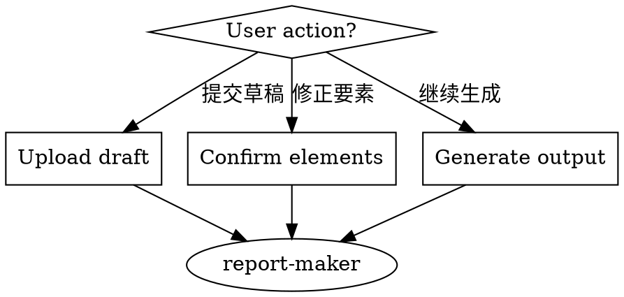
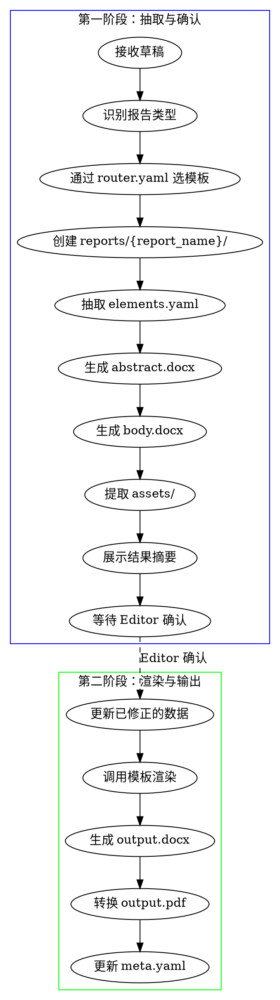

# Report Maker - 报告生成与验证

## Overview

负责 `reports/` 目录的所有写操作。采用两阶段流程：抽取确认 → 渲染输出。核心原则：**只写 reports/，不写 templates/**。

## When to Use



**Use when:**
- 分析师上传草稿，说"生成标准排版报告"
- Editor 修正提取的要素
- Editor 确认后继续生成标准报告

**Do NOT use for:**
- 创建/修改模板（使用 template-maker）
- 修改 schema.yaml（使用 template-maker）
- 修改 router.yaml（使用 template-maker）

## 两阶段流程



**关键规则：只允许在第一阶段切换模板，第二阶段不支持切换。**

## 写权限边界

| 可写 | 不可写 |
|------|--------|
| `reports/{report_name}/*` | `templates/*` |
| 报告的 draft.docx | schema.yaml |
| 报告的 elements.yaml | router.yaml |
| 报告的 abstract.docx | 任何模板文件 |
| 报告的 body.docx | |
| 报告的 assets/* | |
| 报告的 output.docx | |
| 报告的 output.pdf | |
| 报告的 meta.yaml | |

## Quick Reference

| 用户指令 | 阶段 | 触发动作 |
|---------|------|----------|
| "生成标准排版报告" | 第一阶段 | extract_and_confirm |
| "ticker 应该是 700 HK" | 第一阶段 | update_elements |
| "切换到 company 模板" | 第一阶段 | switch_template |
| "确认，继续生成" | 第二阶段 | render_output |
| "重新提取摘要" | 第一阶段 | re_extract |

## Implementation

### 第一阶段：抽取与确认

**1. 接收草稿并识别类型**

```python
# 接收草稿
draft_path = save_draft(uploaded_file)

# 识别报告类型 (通过 LLM)
report_type = detect_report_type(draft_path)

# 通过 router.yaml 路由到模板
with open("templates/router.yaml") as f:
    router = yaml.safe_load(f)
template_name = router['mappings'].get(report_type, 'common')
```

**2. 创建报告目录**

```python
# 规整报告名称
report_name = normalize_name(draft_filename)

# 创建目录
report_dir = f"reports/{report_name}"
os.makedirs(report_dir, exist_ok=True)
os.makedirs(f"{report_dir}/assets", exist_ok=True)

# 保存草稿
shutil.copy(draft_path, f"{report_dir}/draft.docx")
```

**3. 抽取要素**

```python
# 加载 schema
with open(f"templates/{template_name}/schema.yaml") as f:
    schema = yaml.safe_load(f)

# 使用 LLM 抽取要素
elements = extract_elements(draft_path, schema)

# 保存 elements.yaml
save_yaml(elements, f"{report_dir}/elements.yaml")
```

**4. 生成 Word 片段**

```python
from docx import Document

# 从草稿中拆分摘要
abstract_doc = extract_abstract_fragment(draft_path)
abstract_doc.save(f"{report_dir}/abstract.docx")

# 从草稿中拆分正文
body_doc = extract_body_fragment(draft_path)
body_doc.save(f"{report_dir}/body.docx")

# 提取复杂资产 (图表、表格截图)
extract_assets(draft_path, f"{report_dir}/assets/")
```

**5. 展示结果摘要**

```
抽取完成！

报告: 西锐飞机首次覆盖报告
类型: company
模板: company

提取的要素:
- ticker: CIRA US
- company_name: 西锐飞机
- rating: OUTPERFORM
- target_price: 45.00
- analysts: ["张三", "李四"]
...

请检查以上信息，如有错误请告诉我修正。
确认无误后，输入"继续生成"。
```

### 第二阶段：渲染与输出

**1. 更新已修正的数据**

```python
# 如果 Editor 有修正
if corrections:
    elements = load_yaml(f"{report_dir}/elements.yaml")
    elements.update(corrections)
    save_yaml(elements, f"{report_dir}/elements.yaml")
```

**2. 渲染标准报告**

```python
from docxtpl import DocxTemplate

# 加载模板
template = DocxTemplate(f"templates/{template_name}/template.docx")

# 准备渲染上下文
context = prepare_context(elements, report_dir)

# 渲染
template.render(context)
template.save(f"{report_dir}/output.docx")
```

**3. 转换 PDF**

```python
import subprocess

subprocess.run([
    "libreoffice", "--headless",
    "--convert-to", "pdf",
    "--outdir", report_dir,
    f"{report_dir}/output.docx"
])
```

**4. 更新元数据**

```python
meta = {
    'name': report_name,
    'template': template_name,
    'status': 'completed',
    'created_at': datetime.now().isoformat(),
    'elements_file': 'elements.yaml',
    'output_files': ['output.docx', 'output.pdf']
}
save_yaml(meta, f"{report_dir}/meta.yaml")
```

## File Structure

```
reports/
└── {report_name}/
    ├── draft.docx        # 原始草稿
    ├── elements.yaml     # 提取的结构化要素
    ├── abstract.docx     # 摘要 Word 片段 (可直接打开检查)
    ├── body.docx         # 正文 Word 片段 (可直接打开检查)
    ├── assets/           # 图表/截图等复杂资产
    │   ├── chart_1.png
    │   └── table_1.png
    ├── output.docx       # 标准排版输出
    ├── output.pdf        # PDF 发布版
    └── meta.yaml         # 报告元数据
```

### elements.yaml 结构

```yaml
# 基础信息
ticker: "CIRA US"
company_name: "西锐飞机"
rating: "OUTPERFORM"
target_price: 45.00
report_date: "2026-03-24"
title: "首次覆盖：通用航空龙头"

# 分析师
analysts:
  - name: "张三"
    email: "zhangsan@company.com"
    sfc: "12345678"
  - name: "李四"
    email: "lisi@company.com"
    sfc: "87654321"

# 片段引用
abstract_file: "abstract.docx"
body_file: "body.docx"
assets:
  - "assets/chart_1.png"
  - "assets/table_1.png"
```

### meta.yaml 结构

```yaml
name: "西锐飞机首次覆盖报告"
template: "company"
status: "completed"  # draft | extracting | confirmed | completed
created_at: "2026-03-24T10:30:00"
updated_at: "2026-03-24T11:00:00"
elements_file: "elements.yaml"
output_files:
  - "output.docx"
  - "output.pdf"
```

## Common Mistakes

| 错误 | 修正 |
|------|------|
| 第二阶段切换模板 | 只能在第一阶段切换 |
| 直接修改 templates/ | report-maker 只能写 reports/ |
| 跳过确认直接生成 | 必须等 Editor 确认后才能渲染 |
| 用 Markdown 存储片段 | 第一版直接用 Word 片段 |

## Dependencies

**Python packages:**
- `python-docx` - Word 解析和编辑
- `python-docx-template` - 模板渲染 (Jinja2)
- `PyYAML` - 配置文件
- `PyMuPDF` (fitz) - PDF 裁剪图表

**System:**
- LibreOffice - Word 转 PDF
