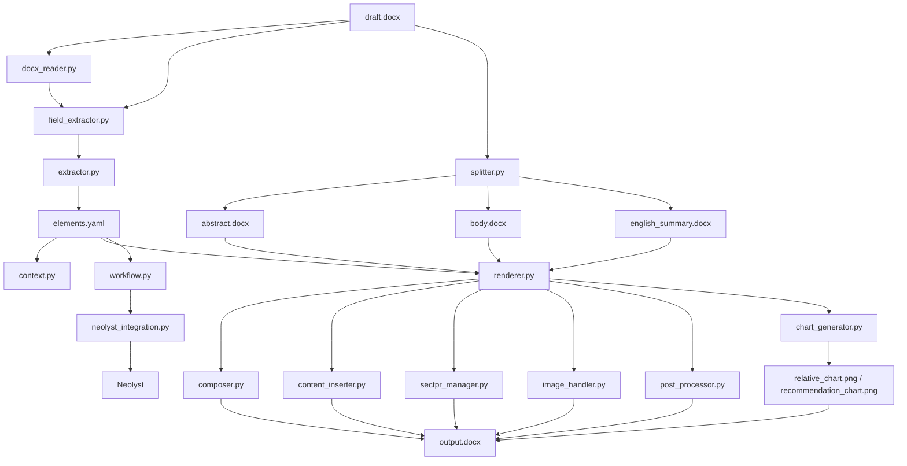

# report_maker 真实架构图与数据契约表

## 1. 文档目的

本文档只描述 `skills/report_maker` 的当前代码事实，不描述理想设计，不替代 `docs/draft` 中的目标方案。

用途只有两个：

1. 作为重构前的基线，明确“现在到底怎么跑”
2. 作为差异核对表，判断代码、测试、文档三者哪里没有对齐

范围基于以下目录的静态阅读：

- `skills/report_maker/scripts/`
- `skills/report_maker/tests/`
- `templates/company/`
- `docs/draft/` 中与 `report_maker` 相关的设计稿

不包含全量运行验证。

## 2. 总判断

`report_maker` 当前是一个过渡系统。它的主干能力已经形成，但运行边界、数据协议和设计文档没有收口到一套事实源。

## 3. 真实模块分层

### 3.1 抽取层

- `docx_reader.py`
  - 用 `lxml` 直接读 `document.xml`
  - 解决嵌套表格读取问题
- `field_extractor.py`
  - 从表格和嵌套表格里做规则提取
  - 当前仍直接提取部分市场字段
- `extractor.py`
  - 抽取总入口
  - 先调用 `field_extractor`
  - 再用可选 LLM fallback 补缺
- `splitter.py`
  - 负责摘要、正文、英文摘要、附录的 Word 片段提取
  - 直接处理 XML、页边距和分节符

### 3.2 渲染层

- `renderer.py`
  - 渲染总入口
  - 调度 abstract/body/english_summary 插入
  - 调度图表生成和后处理
- `composer.py`
  - 负责 body 的 docxcompose 三段式合并
- `content_inserter.py`
  - 负责 abstract/english_summary 的 marker 替换
- `sectpr_manager.py`
  - 负责 sectPr 保存、替换、恢复
- `image_handler.py`
  - 负责图片复制和 chart XML 处理
- `post_processor.py`
  - 负责字体约束、附录验证、分析师认证扩展
- `chart_generator.py`
  - 负责 `relative_chart` 和 `recommendation_chart`

### 3.3 基础设施层

- `common.py`
  - 常量、文件名、YAML、docx zip 操作
- `context.py`
  - 渲染上下文准备
  - 补公司名
  - 展开分析师相关字段
- `market_data.py`
  - 从 Neolyst 历史推荐记录生成 recommendation chart 输入

### 3.4 外部系统边界

- `neolyst_integration.py`
  - 模板解析
  - 分析师解析
  - coverage 解析
  - draft 保存、校验、提交、文件上传
- `workflow.py`
  - 草稿保存和提交流程编排

## 4. 真实调用关系

## 5. 运行主流程

### 5.1 当前代码事实流程

1. 读取 schema
2. 初始化 `elements`
3. 用 `field_extractor` 提取普通字段
4. 用可选 LLM fallback 补缺
5. 用 `splitter` 生成 `abstract.docx`、`body.docx`、`english_summary.docx`
6. 用 `renderer.render_report()` 渲染模板
7. 可选进入 `workflow.py`，将结果保存/提交到 Neolyst

### 5.2 当前主流程与设计稿的差异

- 当前代码仍保留本地 `router.yaml` 路径
- 当前代码没有完整落地“第二阶段刷新 `source: market`”
- 当前代码的图表实现是 `relative_chart + recommendation_chart`
- 设计稿的增量方案写的是 `stock_price_chart`

## 6. 数据契约表

### 6.1 `elements.yaml` 契约

| 对象 | 当前代码约定 | 当前消费者 | 风险 |
|------|--------------|------------|------|
| 普通标量字段 | 字符串为主 | `renderer.py`、`workflow.py` | 基本稳定 |
| `abstract` | 默认是 `abstract.docx` 文件名 | `renderer.py`、`neolyst_integration.py` | 被误当正文文本使用 |
| `body` | 默认是 `body.docx` 文件名 | `renderer.py` | 与设计一致 |
| `english_summary` | schema 中定义为 fragment | `renderer.py` | 与 `common.init_elements_from_schema()` 未完全对齐 |
| `relative_chart` | schema 中为自动生成字段 | `renderer.py` | 与增量设计不一致 |
| `recommendation_chart` | schema 中为自动生成字段 | `renderer.py` | 与增量设计不一致 |
| `relative_chart_generated` | 布尔状态字段 | `validate_elements_against_schema()` | 依赖图表生成成功 |
| `recommendation_chart_generated` | 布尔状态字段 | `validate_elements_against_schema()` | 依赖图表生成成功 |

### 6.2 分析师字段契约

当前代码里至少存在三套相关协议。

| 协议 | 字段形态 | 生产者 | 消费者 | 现状 |
|------|----------|--------|--------|------|
| 模板/schema 槽位协议 | `a1_cn/a1_en/a1_email/a1_sfc` | `templates/company/schema.yaml` | `renderer.py`、`context.py`、`post_processor.py` | 当前主协议 |
| workflow 提交协议 | `a1` 到 `a8` 只存邮箱 | `neolyst_integration.py` 假定输入 | `workflow.py` | 与 schema 断裂 |
| 聚合 analysts 协议 | `analysts: list[dict]` | 手工构造或外部传入 | `context.py` | 只在部分路径使用 |

结论：

- 渲染路径主要依赖 `a1_cn/a1_en/a1_email/a1_sfc`
- 提交路径主要依赖 `a1` 到 `a8`
- 两者当前没有统一转换层

### 6.3 `abstract` 字段契约

| 语义 | 当前实现 |
|------|----------|
| 初始化语义 | 文件引用，默认值 `abstract.docx` |
| 渲染语义 | 作为外部 Word 片段路径使用 |
| Neolyst draft 语义 | 被 `map_elements_to_draft()` 当成摘要文本压缩为 `investment_thesis` |

结论：

`abstract` 当前同时承担“文件路径”和“摘要文本”两种语义，已经冲突。

### 6.4 模板解析契约

| 路径 | 当前实现 | 设计要求 |
|------|----------|----------|
| 旧路径 | `common.get_template_name()` 读 `router.yaml` | 已废弃 |
| 新路径 | `resolve_template_for_report()` 走 Neolyst | 设计主路径 |
| 测试现状 | 集成测试仍使用旧路径 | 未迁移完成 |

### 6.5 Neolyst draft 契约

`map_elements_to_draft()` 目前映射的关键字段如下：

| draft 字段 | 当前来源 |
|------------|----------|
| `title` | `elements["title"]` |
| `report_type` | workflow 输入 |
| `report_language` | 由标题字符集推断 |
| `analysts` | `resolve_analysts_from_elements()` |
| `report_file` | workflow 输入 |
| `pdf_file` | workflow 输入 |
| `contact_person` | 默认第一作者邮箱 |
| `investment_thesis` | 默认对 `elements["abstract"]` 做截断 |
| `coverage_id` | 公司类报告按 `ticker + 首作邮箱` 查 |
| `ticker/rating/target_price` | 从 `elements` 直接取 |
| `region_code/sector_id` | 行业类报告从 `elements` 取 |

最大问题：

- `investment_thesis` 来源错位
- `analysts` 解析协议错位

## 7. 模块边界判断

### 7.1 边界清晰的部分

- `docx_reader.py`
  - 输入/输出明确
  - 只负责读取结构
- `market_data.py`
  - 只做历史推荐数据转换
- `content_inserter.py`
  - 只负责 marker 替换和页边距应用

### 7.2 边界模糊的部分

- `renderer.py`
  - 仍承担总编排职责
  - 临时文件、图表、模板修复、插入、后处理都汇总在一处
- `splitter.py`
  - 片段提取、启发式定位、页边距恢复、附录识别都塞在一个文件
- `neolyst_integration.py`
  - 同时承担模板解析、分析师、coverage、draft、上传五类边界

## 8. 测试覆盖事实

### 8.1 当前已有测试重心

- 强：`field_extractor`、`docx_reader`、`splitter`、`content_inserter`、`sectpr_manager`、`composer`
- 中：`context`、`chart_generator`、`post_processor`
- 弱：`workflow`、`neolyst_integration`

### 8.2 当前缺口

- 没有 `test_workflow.py`
- 没有 `test_neolyst_integration.py`
- 集成测试仍绑定旧模板路由方式
- 文档中的测试数量描述已经过期

## 9. 当前最关键的四个契约冲突

1. 分析师字段协议冲突
   - schema/模板使用 `a1_cn/a1_en/a1_email/a1_sfc`
   - workflow 提交使用 `a1` 到 `a8`

2. `abstract` 语义冲突
   - 渲染时是文件路径
   - 提交 draft 时被当摘要文本

3. 模板来源冲突
   - 文档要求运行时只走 Neolyst
   - 代码和测试仍保留 `router.yaml`

4. 市场数据方案冲突
   - 设计要求第二阶段刷新
   - 当前实现仍主要在第一阶段提取

## 10. 重构时建议先冻结的事实

如果后续要继续拆 `report_maker`，建议先冻结下面三件事，否则重构只会放大歧义：

1. `elements.yaml` 的唯一字段协议
2. 运行时模板的唯一事实源
3. `investment_thesis`、`analysts`、市场字段的唯一来源

在这三件事未冻结前，不建议先拆 `renderer.py` 或大规模拆 `splitter.py`。
