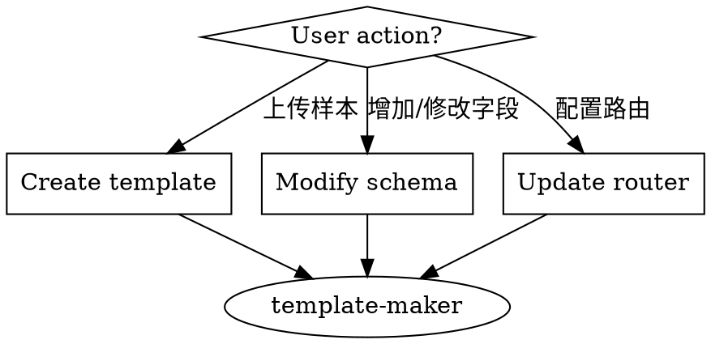
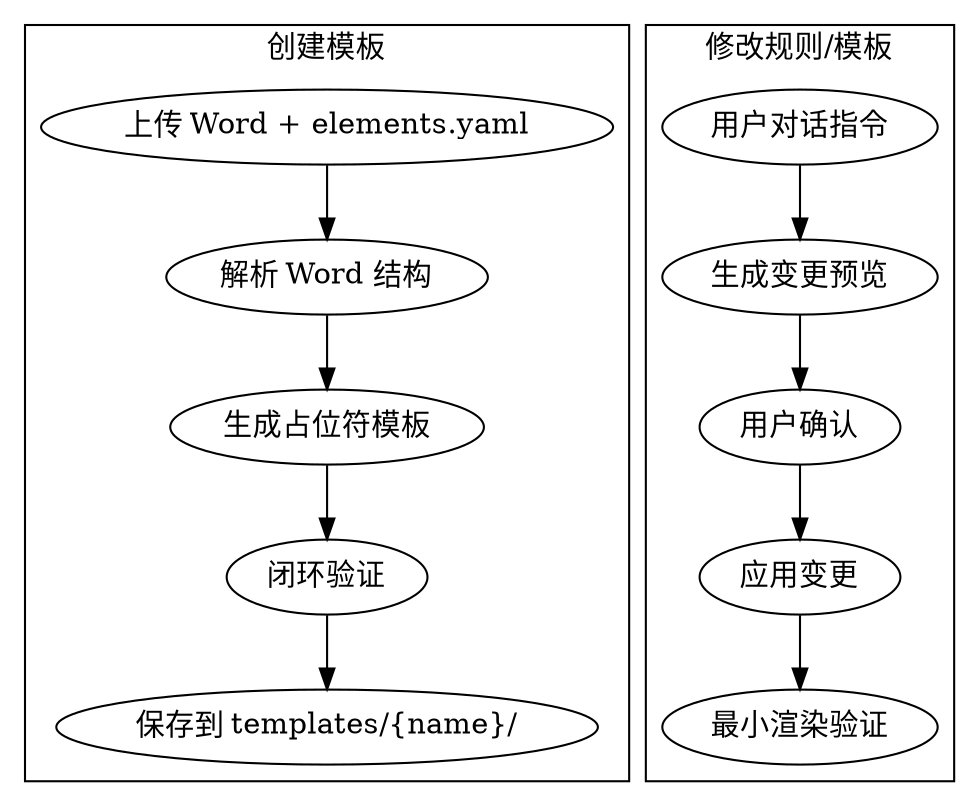

# Template Maker - 模板制作与维护

## Overview

负责 `templates/` 目录的所有写操作。通过对话方式创建和维护报告模板、提取规则和路由配置。核心原则：**只写 templates/，不写 reports/**。

## When to Use



**Use when:**
- 用户上传 Word 样本 + elements.yaml，说"设为 XX 模板"
- 用户说"增加/修改/删除'XX'字段"
- 用户说"把 macro 报告类型映射到 common 模板"
- 用户说"验证模板"

**Do NOT use for:**
- 处理分析师草稿（使用 report-maker）
- 生成标准报告（使用 report-maker）
- 写入 reports/ 目录

## Core Workflow



## 写权限边界

| 可写 | 不可写 |
|------|--------|
| `templates/router.yaml` | `reports/*` |
| `templates/{name}/schema.yaml` | `skills/*` (除自身) |
| `templates/{name}/template.docx` | 任何报告产物 |
| `templates/{name}/meta.yaml` | |

## Quick Reference

| 用户指令 | 触发动作 | 输出 |
|---------|----------|------|
| "将其设为 common 模板" | create_template | 创建 templates/common/ |
| "增加'风险提示'字段" | update_schema | 更新 schema.yaml + template.docx |
| "把 macro 映射到 common" | update_router | 更新 router.yaml |
| "验证 common 模板" | validate_template | 验证结果报告 |

## Implementation

### 1. 创建模板 (create_template)

**输入:**
- `word_file`: 标准样本 Word
- `elements_file`: elements.yaml (可选)
- `template_name`: 模板名称

**输出:**
```
templates/{template_name}/
├── schema.yaml      # 从样本推断的字段规则
├── template.docx    # 带占位符的模板
└── meta.yaml        # 元数据
```

**流程:**
```python
# 1. 解析 Word
from docx import Document
doc = Document(word_file)

# 2. 识别占位符区域
placeholders = detect_placeholders(doc, elements)

# 3. 生成 schema.yaml
schema = generate_schema(placeholders)

# 4. 创建模板目录
os.makedirs(f"templates/{template_name}", exist_ok=True)

# 5. 保存模板文件
save_template(doc, f"templates/{template_name}/template.docx")
save_yaml(schema, f"templates/{template_name}/schema.yaml")
save_meta(template_name, f"templates/{template_name}/meta.yaml")

# 6. 闭环验证
result = validate_template(template_name, elements)
```

### 2. 更新规则 (update_schema)

**流程:**
1. 解析用户指令，提取字段信息
2. 生成变更预览（默认先展示）
3. 用户确认后应用变更
4. 同时更新 schema.yaml 和 template.docx
5. 执行最小渲染验证

**变更预览示例:**
```
变更预览:
- schema.yaml: 新增字段 'risk_warning'
- template.docx: 在"免责声明"前插入占位符 {{risk_warning}}

确认应用? (是/否/直接应用)
```

### 3. 更新路由 (update_router)

**router.yaml 结构:**
```yaml
# 报告类型 -> 模板名 的静态映射
mappings:
  company: company
  sector: sector
  company_flash: company
  sector_flash: sector
  macro: common
  strategy: common
  quant: common
  bond: common
```

### 4. 验证模板 (validate_template)

**流程:**
1. 加载模板和 schema
2. 用示例数据渲染
3. 检查占位符替换完整性
4. 返回验证报告

## File Structure

```
templates/
├── router.yaml              # 全局路由配置
└── {template_name}/
    ├── schema.yaml          # 提取规则
    ├── template.docx        # Word 模板
    └── meta.yaml            # 元数据
```

### schema.yaml 结构

```yaml
name: common
version: "1.0"

required_fields:
  - title
  - report_date
  - analysts
  - abstract
  - body

fields:
  title:
    description: "报告标题"
    type: string
    extraction_prompt: "提取报告标题"
  report_date:
    description: "报告日期"
    type: date
    format: "YYYY-MM-DD"
  analysts:
    description: "分析师列表"
    type: array
    items:
      name: string
      email: string
      sfc: string
  abstract:
    description: "摘要"
    type: docx_fragment
  body:
    description: "正文"
    type: docx_fragment
```

### meta.yaml 结构

```yaml
name: common
description: "通用报告模板 (宏观/策略/量化/债券)"
created_at: "2026-03-24"
updated_at: "2026-03-24"
version: "1.0"
status: active
```

## Common Mistakes

| 错误 | 修正 |
|------|------|
| 直接修改 reports/ 目录 | template-maker 只能写 templates/ |
| 跳过验证直接应用 | 默认先预览，用户确认后才应用 |
| 忘记更新 router.yaml | 新模板需要配置路由映射 |
| 占位符格式不一致 | 统一使用 `{{field_name}}` 格式 |

## Dependencies

**Python packages:**
- `python-docx` - Word 解析和编辑
- `python-docx-template` - 模板渲染 (Jinja2)
- `PyYAML` - 配置文件

**System:**
- LibreOffice (可选，用于验证时的 PDF 转换)
